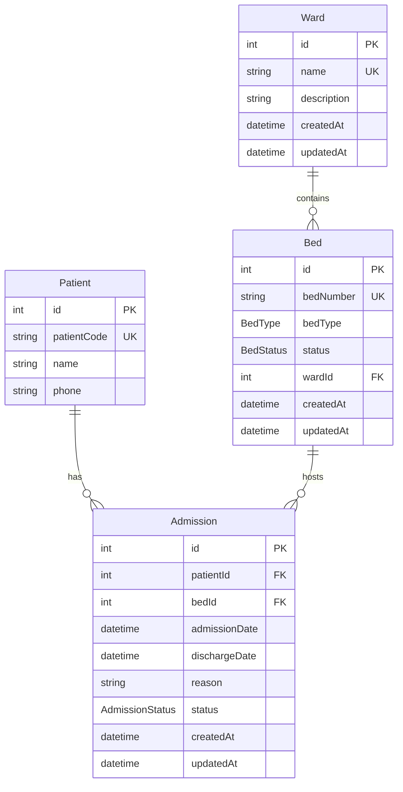

# AetherCare — Bed & Admissions Management Integration & Handover

## 1. Overview & Module Architecture

The **Bed Management** and **Admissions Management** modules have been integrated into the AetherCare backend according to the layered architecture:

```text
HTTP Request → Express Routes → Controllers → Services (with Transactions) → Prisma ORM 7 → PostgreSQL
```

Both modules integrate with the existing `Patient` module, sharing Prisma models, error handling conventions, and database connection pools without modifying any unrelated application logic.

---

## 2. Environment & Database Requirements

- **Runtime**: Node.js v18+ (tested on v25)
- **Database**: PostgreSQL 14+
- **Prisma Configuration**: `server/prisma7.config.ts` loading configuration from `server/.env`

### Environment Configuration (`server/.env`)
```env
DATABASE_URL="postgresql://<username>:<password>@localhost:5432/aethercare?schema=public"
PORT=5000
```
> **Security Notice**: Never commit `.env` or database credentials to version control.

### Applying Database Migrations
Run from the `server/` directory:
```bash
npx prisma migrate deploy --config prisma7.config.ts
npx prisma generate --config prisma7.config.ts
```

---

## 3. Database Models & Relationships



### Enums
- **`BedType`**: `GENERAL`, `ICU`, `PRIVATE`
- **`BedStatus`**: `AVAILABLE`, `OCCUPIED`, `MAINTENANCE`
- **`AdmissionStatus`**: `ADMITTED`, `DISCHARGED`, `CANCELLED`

---

## 4. API Endpoint Documentation

### 4.1 Ward Management

| Method | Endpoint | Description |
|---|---|---|
| `POST` | `/api/wards` | Create a new hospital ward (`name` required & unique, optional `description`) |
| `GET` | `/api/wards` | Retrieve all wards with associated bed counts |

#### Create Ward Request Example
```json
POST /api/wards
{
  "name": "General Ward A",
  "description": "General inpatient ward on 2nd floor"
}
```

---

### 4.2 Bed Management

| Method | Endpoint | Description |
|---|---|---|
| `POST` | `/api/beds` | Create a bed (`bedNumber` unique, `wardId` required, optional `bedType`, `status`) |
| `GET` | `/api/beds` | List all beds (supports `wardId`, `status`, `bedType` query filters) |
| `GET` | `/api/beds/available` | Filter available beds (supports `wardId`, `bedType` query filters) |
| `GET` | `/api/beds/:id` | Get details of a single bed including ward details |
| `PATCH` | `/api/beds/:id` | Update bed fields (`bedNumber`, `bedType`, `status`, `wardId`) |

#### Query Filtering Examples
- `/api/beds?wardId=1`
- `/api/beds?status=AVAILABLE`
- `/api/beds?bedType=ICU`
- `/api/beds/available?wardId=1&bedType=GENERAL`

> **Business Rule**: Occupied beds cannot be manually modified to `AVAILABLE`. They must be released through patient discharge.

---

### 4.3 Admissions Management

| Method | Endpoint | Description |
|---|---|---|
| `POST` | `/api/admissions` | Admit a patient (`patientId`, `bedId`, optional `reason`) |
| `GET` | `/api/admissions` | List all admissions (supports `patientId`, `status` query filters) |
| `GET` | `/api/admissions/active` | List currently active admissions (`status: ADMITTED`) |
| `GET` | `/api/admissions/:id` | Get admission details with patient and bed information |
| `PATCH` | `/api/admissions/:id` | Update admission metadata (e.g. `reason`) |
| `PATCH` | `/api/admissions/:id/discharge` | Atomically discharge patient and release bed |

---

## 5. Transaction Safety & Concurrency Handling

### Admission Creation Transaction
1. Checks that the patient exists.
2. Verifies that the patient does not already have an active admission (`ADMITTED`).
3. Verifies that the bed exists and is not under `MAINTENANCE`.
4. Executes an atomic conditional update:
   ```javascript
   const updateResult = await tx.bed.updateMany({
       where: { id: bedId, status: "AVAILABLE" },
       data: { status: "OCCUPIED" }
   });
   ```
5. If `updateResult.count === 0`, bed was claimed concurrently or is unavailable; the transaction aborts and returns HTTP 409 Conflict.
6. Creates the `Admission` record linked to patient and bed with status `ADMITTED`.

### Patient Discharge Transaction
1. Retrieves admission record and verifies current status is `ADMITTED`.
2. Rejects double-discharge requests with HTTP 400.
3. Sets admission status to `DISCHARGED` and populates `dischargeDate = new Date()`.
4. Atomically resets the associated bed's status to `AVAILABLE`.

---

## 6. Testing & Insomnia Collection

### Insomnia API Collection
An importable Insomnia v4 collection is located at:
[insomnia/AetherCare_API.json](file:///Users/avkashsingh/Desktop/manish%20main%20project/insomnia/AetherCare_API.json)

It contains organized folders for:
- **Health**: Health check endpoint
- **Beds**: Create Ward, Get All Wards, Create Bed, Get All Beds, Get Bed by ID, Get Available Beds, Filter Beds by Ward, Filter Beds by Status, Update Bed
- **Admissions**: Create Admission, Get All Admissions, Get Admission by ID, Get Active Admissions, Get Patient Admissions, Update Admission, Discharge Patient

### Running Automated E2E Test Suite
A comprehensive 20-test automated verification script is available:
```bash
cd server
node src/tests/e2e-workflow.test.js
```
The test suite validates:
1. End-to-end 16-step ward, bed, admission, and discharge workflow.
2. Rejection of duplicate admissions for same patient.
3. Rejection of duplicate bed assignment.
4. Concurrency protection with simultaneous parallel claims.
5. Rejection of invalid foreign keys (patientId, bedId, wardId).
6. Prevention of manual status override on occupied beds.

---

## 7. Handover Notes for Team Members

1. **Prisma Client Generation**: Whenever pulling this code, run `npx prisma generate --config prisma7.config.ts` from the `server/` directory.
2. **Migrations**: All migrations (`add_ward_and_bed`, `add_admission_model`) are committed under `server/prisma/migrations/`.
3. **Route Mounts**: In `server/src/app.js`:
   - `/api/wards` → `ward.routes.js`
   - `/api/beds` → `bed.routes.js`
   - `/api/admissions` → `admission.routes.js`
4. **Existing Code**: Existing Patient Management (`/api/patients`) and OPD modules (`/api/departments`, `/api/doctors`) are preserved and verified working with 100% backward compatibility.
