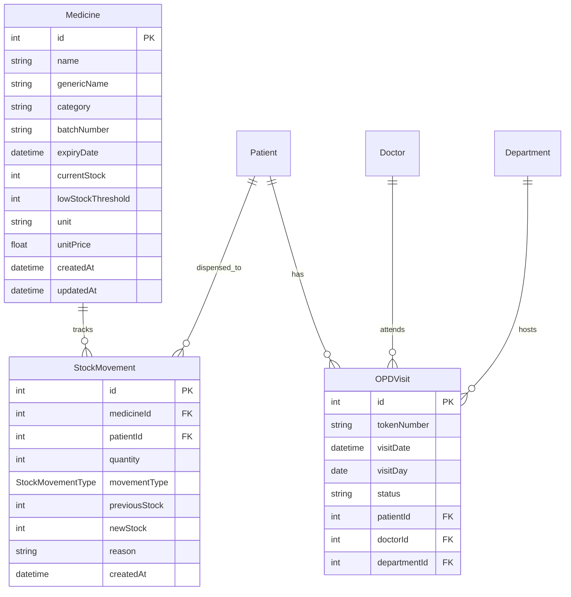

# AetherCare — Inventory Management & OPD Queue Integration & Handover

## 1. Overview & Module Architecture

The **Inventory Management** and **OPD Queue Management** modules complete Day 3 of the AetherCare MVP roadmap. They follow the established multi-layer architecture:

```text
HTTP Request → Express Routes → Controllers → Services (with Transactions) → Prisma ORM 7 → PostgreSQL
```

Both modules integrate directly with the existing `Patient`, `Doctor`, and `Department` models, sharing Prisma clients, authentication middleware, and database connection pools without modifying existing application logic.

---

## 2. Environment & Database Requirements

- **Runtime**: Node.js v18+ (tested on v25)
- **Database**: PostgreSQL 14+
- **Prisma Configuration**: `server/prisma7.config.ts` loading configuration from `server/.env`

### Applying Database Migrations
Run from the `server/` directory:
```bash
npx prisma migrate deploy --config prisma7.config.ts
npx prisma generate --config prisma7.config.ts
```

---

## 3. Database Models & Relationships



### Enums
- **`StockMovementType`**: `RESTOCK`, `DISPENSED`, `ADJUSTMENT`, `DISCARDED`
- **OPD Visit Status**: `WAITING`, `IN_CONSULTATION`, `COMPLETED`, `CANCELLED`

---

## 4. API Endpoint Documentation

### 4.1 Inventory Management (`/api/inventory`)

| Method | Endpoint | Description | Allowed Roles |
|---|---|---|---|
| `POST` | `/api/inventory/medicines` | Add medicine to catalogue (with initial stock tracking) | ADMIN, NURSE, DOCTOR |
| `GET` | `/api/inventory/medicines` | List & search medicines (`search`, `category`, `lowStock` filters) | ALL ROLES |
| `GET` | `/api/inventory/medicines/:id` | Get single medicine details with recent movement logs | ALL ROLES |
| `PATCH` | `/api/inventory/medicines/:id` | Update medicine metadata (pricing, threshold, batch) | ADMIN, NURSE, DOCTOR |
| `POST` | `/api/inventory/medicines/:id/restock` | Restock medicine and record audit movement | ADMIN, NURSE, DOCTOR |
| `POST` | `/api/inventory/medicines/:id/issue` | Issue medicine for patient treatment with concurrency check | ADMIN, NURSE, DOCTOR |
| `POST` | `/api/inventory/medicines/:id/adjust` | Manually adjust stock count with variance logging | ADMIN, NURSE, DOCTOR |
| `GET` | `/api/inventory/low-stock` | Real-time low-stock alerts (`currentStock <= lowStockThreshold`) | ALL ROLES |
| `GET` | `/api/inventory/movements` | List stock movement audit history | ALL ROLES |

#### Example: Issue Medicine for Patient Treatment
```json
POST /api/inventory/medicines/1/issue
{
  "quantity": 5,
  "patientId": 1,
  "reason": "Post-admission antibiotic treatment"
}
```

---

### 4.2 OPD Queue Management (`/api/opd-visits`)

| Method | Endpoint | Description | Allowed Roles |
|---|---|---|---|
| `POST` | `/api/opd-visits` | Create OPD visit & generate daily token (e.g. `OPD-001`) | ADMIN, RECEPTIONIST, DOCTOR |
| `GET` | `/api/opd-visits` | List queue visits (`departmentId`, `doctorId`, `visitDate`, `status` filters) | ALL ROLES |
| `PATCH` | `/api/opd-visits/:id/status` | Advance visit status (`WAITING`, `IN_CONSULTATION`, `COMPLETED`, `CANCELLED`) | ADMIN, RECEPTIONIST, DOCTOR |

---

## 5. Concurrency & Transaction Safety

### 5.1 Atomic Stock Deduction on Issue
1. Verifies medicine exists and patient exists (if `patientId` is provided).
2. Performs an atomic conditional update:
   ```javascript
   const updateResult = await tx.medicine.updateMany({
       where: { id: medicineId, currentStock: { gte: quantity } },
       data: { currentStock: { decrement: quantity } }
   });
   ```
3. If `updateResult.count === 0`, stock was claimed concurrently or is insufficient; returns HTTP 409 Conflict without modifying state.
4. Generates an immutable `StockMovement` audit record linked to the medicine and patient.

### 5.2 Atomic Restock and Adjustment
- Restocking and manual inventory adjustments are executed inside atomic Prisma transactions to prevent race conditions during high-volume clinic operations.

---

## 6. Automated Testing

Run the full automated test suites:
```bash
cd server
npm test
```
The test command executes:
1. `src/tests/e2e-workflow.test.js`: 20 end-to-end tests covering ward, bed, admission, and discharge workflows.
2. `src/tests/inventory-opd.test.js`: 16 tests covering medicine registration, search, restock, treatment dispensation, concurrency protection, low-stock alerts, and OPD queue transitions.

---

## 7. Handover Notes for Team Members

1. **Prisma Client**: When pulling, run `npx prisma generate --config prisma7.config.ts` from `server/`.
2. **Migrations**: Migration `20261115050646_add_inventory_management` is committed under `server/prisma/migrations/`.
3. **Route Mounting**:
   - `/api/inventory` → `inventory.routes.js`
   - `/api/opd-visits` → `visit.routes.js` (now with `GET` and `PATCH` support)
4. **Backward Compatibility**: All previous endpoints (`/api/patients`, `/api/departments`, `/api/doctors`, `/api/wards`, `/api/beds`, `/api/admissions`, `/api/auth`) continue to function without changes.
